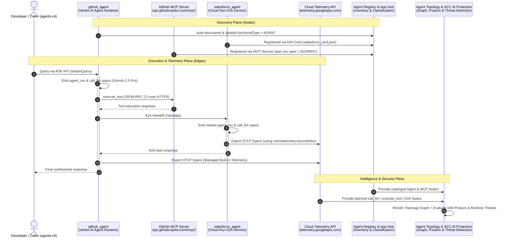

# [FDE] Observe and Secure a Multi-Agent System: Challenge Lab

> **Enterprise Reference Architecture & Step-by-Step Challenge Lab Guide**  
> Instrumenting Distributed Multi-Agent Systems with OpenTelemetry & Cloud Trace, Unified Multi-Runtime Discovery via App Hub & Agent Registry (A2A & MCP), Visualizing Cross-Runtime Relationships in Agent Topology, Enforcing Least-Privilege IAM with Security Command Center (SCC) AI Protection & Policy Analyzer, and Detecting Live Container Attacks with Agent Platform Threat Detection.

---

## Table of Contents

1. [Challenge Overview](#challenge-overview)
   - [Step-by-Step Workflow](#step-by-step-workflow)
   - [End-to-End Observability & Security Architecture](#end-to-end-observability--security-architecture)
   - [Multi-Runtime Discovery & Telemetry Matrix](#multi-runtime-discovery--telemetry-matrix)
   - [Topics Tested](#topics-tested)
   - [Prerequisites](#prerequisites)
2. [Setup and Requirements](#setup-and-requirements)
   - [Before You Click the Start Lab Button](#before-you-click-the-start-lab-button)
   - [How to Start Your Lab and Sign In to the Google Cloud Console](#how-to-start-your-lab-and-sign-in-to-the-google-cloud-console)
3. [Repository Architecture & Directory Layout](#repository-architecture--directory-layout)
4. [Complete Step-by-Step Implementation Guide](#complete-step-by-step-implementation-guide)
   - [Task 1. Prepare Your Environment](#task-1-prepare-your-environment)
   - [Task 2. Export Traces to Cloud Trace](#task-2-export-traces-to-cloud-trace)
   - [Task 3. Confirm the Agent Runtime Agents Are Already Discovered](#task-3-confirm-the-agent-runtime-agents-are-already-discovered)
   - [Task 4. Register the Cloud Run Agent](#task-4-register-the-cloud-run-agent)
   - [Task 5. Register the GitHub MCP Server](#task-5-register-the-github-mcp-server)
   - [Task 6. View the Agent Topology Graph](#task-6-view-the-agent-topology-graph)
   - [Task 7. See the Fleet in SCC AI Protection, Then Introduce a Realistic Risk](#task-7-see-the-fleet-in-scc-ai-protection-then-introduce-a-realistic-risk)
   - [Task 8. Identify the Security Finding and Its Scope Using Policy Analyzer](#task-8-identify-the-security-finding-and-its-scope-using-policy-analyzer)
   - [Task 9. Fix It and Verify Least Privilege](#task-9-fix-it-and-verify-least-privilege)
   - [Task 10. (Optional Exercise) Trigger and View an Agent's Runtime Attacks](#task-10-optional-exercise-trigger-and-view-an-agents-runtime-attacks)
5. [Troubleshooting & Operational Notes](#troubleshooting--operational-notes)

---

## Challenge Overview

In the **Build Enterprise Agents** lab you built a multi-agent system spanning two different runtimes: `github_agent` on **Agent Runtime** (Vertex AI Agent Engine) and `salesforce_agent` on **Cloud Run**, where `github_agent` reaches an external **GitHub MCP server** for its tools and communicates over the **Agent2Agent (A2A)** protocol.

You can run that system, but you can't yet see it end to end or reason about its security. In this lab you add the **observability and security layer**. You turn on distributed tracing, ensure all the agents and the MCP server are registered so the platform can discover them, view the whole system as an **Agent Topology** graph, and review the fleet's inventory, posture, and threats in **Security Command Center (SCC) AI Protection**.

Both **Agent Topology** and **SCC AI Protection** depend on the same inputs: **trace data** plus **App Hub** and **Agent Registry** discovery. The goal of this lab is to learn how to instrument your agents so they're observable and how to secure them.

> **At a glance:** Your multi-agent fleet is instrumented and registered, then observed with **Agent Topology** and secured with **SCC AI Protection**.

> **Note:** Agent Topology and parts of SCC AI Protection build their results from aggregated data in batches (for topology, from trace data; for SCC, from usage analysis and attack-path simulations that run about every six hours). You configure everything they need in this lab, but the finished topology graph and some SCC findings can take time, up to a few hours, to appear. You may not see the fully rendered graph or every finding before the lab ends, and that's expected. You can optionally return to the environment to view these after the lab is complete.
>
> This lab continues from the previous lab in this course and assumes the `github_agent` and `salesforce_agent` fleet is already deployed in this project.

---

### Step-by-Step Workflow

*High-level progression across environment preparation, OpenTelemetry tracing, multi-runtime discovery, topology visualization, and security posture/threat management:*

```mermaid
flowchart LR
    subgraph Phase1["Phase 1: Environment & Telemetry (Tasks 1–2)"]
        T1["Task 1: Prepare Environment\nVerify Fleet & Enable\nObservability/Discovery APIs"] --> T2["Task 2: Cloud Trace Export\nVerify OTel GenAI Spans &\nGrant roles/telemetry.tracesWriter"]
    end

    subgraph Phase2["Phase 2: Multi-Runtime Discovery (Tasks 3–6)"]
        T2 --> T3["Task 3: Agent Runtime Discovery\nVerify Auto-Discovery in\nAgent Registry & App Hub"]
        T3 --> T4["Task 4: Cloud Run A2A Registration\nGrant Discovery Engine Invoker &\nRegister salesforce_card.json"]
        T4 --> T5["Task 5: MCP Server Registration\nRegister github-mcp Endpoint\n(no-spec / JSONRPC)"]
        T5 --> T6["Task 6: Agent Topology Graph\nVisualize Cross-Runtime Nodes\n& Trace-Derived Edges"]
    end

    subgraph Phase3["Phase 3: IAM Posture & Least Privilege (Tasks 7–9)"]
        T6 --> T7["Task 7: SCC AI Protection\nInspect Inventory & Simulate\nroles/editor Over-Privilege"]
        T7 --> T8["Task 8: Policy Analyzer Audit\nQuantify Blast Radius of\nOver-Privileged Service Account"]
        T8 --> T9["Task 9: Least-Privilege Remediation\nVerify 4 Narrow Roles &\nRevoke roles/editor"]
    end

    subgraph Phase4["Phase 4: Runtime Threat Detection (Task 10)"]
        T9 --> T10["Task 10: Threat Detection Test\nDeploy Ephemeral Agent, Trigger\nEICAR Detector & Inspect Finding"]
    end
```



---

### End-to-End Observability & Security Architecture

*How runtime interactions, OpenTelemetry spans, and discovery metadata converge to power Agent Topology and SCC AI Protection:*



---

### Multi-Runtime Discovery & Telemetry Matrix

Understanding how different runtimes export telemetry and register their identities is the core architectural concept of this lab:

| Component | Runtime Environment | Telemetry Export Mechanism | IAM Role Required for Tracing | Discovery & Registration Mechanism |
| :--- | :--- | :--- | :--- | :--- |
| **`github_agent`** | **Vertex AI Agent Runtime** (`reasoningEngines`) | Managed built-in telemetry + `google-adk[otel-gcp]` (`telemetry.googleapis.com`) | Managed automatically by the Agent Runtime service agent (no manual per-agent grant required) | **Automatic:** Cataloged by App Hub with `functionalType.type = AGENT` and listed automatically in Agent Registry. |
| **`salesforce_agent`** | **Cloud Run** (`salesforce-agent`) | OpenTelemetry OTLP exporter in `app/app_utils/telemetry.py` (`get_gcp_exporters(enable_cloud_tracing=True)`) | Must explicitly grant **`roles/telemetry.tracesWriter`** to the Cloud Run service account (`PROJECT_NUMBER-compute@developer.gserviceaccount.com`) | **Manual A2A Registration:** Grant `roles/run.invoker` to the Discovery Engine service agent, fetch `/a2a/app/.well-known/agent-card.json`, and register via `gcloud alpha agent-registry services create` (`--agent-spec-type=a2a-agent-card`). |
| **`github-mcp`** | **External Remote MCP Server** (`https://api.githubcopilot.com/mcp/`) | Observed via client-side `execute_tool` spans emitted by `github_agent` | N/A (External endpoint) | **Manual MCP Registration:** Requires App Hub API enabled (`apphub.googleapis.com`), then registered via `gcloud alpha agent-registry services create` (`--mcp-server-spec-type=no-spec`, `protocolBinding=JSONRPC`). |

---

### Topics Tested

This lab challenges you to demonstrate your ability to do the following:

- Verify how the agents are instrumented for tracing, and grant the identity that exports their traces.
- Register the Cloud Run agent and the GitHub MCP server so the platform can discover them.
- Configure a multi-agent system for Agent Topology and view its graph.
- Create, find, and fix an over-privileged agent service account using Policy Analyzer.
- *(Optional)* Detect a runtime threat against an agent with Agent Platform Threat Detection.

---

### Prerequisites

> **Important:** Save your third-party credentials in a persistent local location.

This lab interacts with external third-party platforms. If you plan to complete the related labs (*Build Enterprise Agents* and *Agent Identity Foundations*), you will reuse the same third-party credentials across those sessions.

Save the following credentials:

- **GitHub:** Personal Access Token (classic) with `repo` and `read:org` scopes
- **Salesforce:** Connected App Consumer Key (Client ID)
- **Salesforce:** Connected App Consumer Secret (Client Secret)
- **Salesforce:** My Domain URL

Before you begin, confirm that in this Google Cloud project you have:

- The agent fleet from *Build Enterprise Agents* deployed and running: `github_agent` on Agent Runtime, and `salesforce_agent` on Cloud Run, with the GitHub MCP server in use by `github_agent`.
- The agent code available at `gs://PROJECT_ID-bucket/agents`.
- You should be comfortable with `gcloud`, `agents-cli`, and ADK multi-agent systems.

---

## Setup and Requirements

### Before You Click the Start Lab Button

Read these instructions. Labs are timed and you cannot pause them. The timer, which starts when you click **Start Lab**, shows how long Google Cloud resources are made available to you.

This hands-on lab lets you do the lab activities in a real cloud environment, not in a simulation or demo environment. It does so by giving you new, temporary credentials you use to sign in and access Google Cloud for the duration of the lab.

To complete this lab, you need:

- Access to a standard internet browser (Chrome browser recommended).
  > **Note:** Use an Incognito (recommended) or private browser window to run this lab. This prevents conflicts between your personal account and the student account, which may cause extra charges incurred to your personal account.
- Time to complete the lab—remember, once you start, you cannot pause a lab.
  > **Note:** Use only the student account for this lab. If you use a different Google Cloud account, you may incur charges to that account.

### How to Start Your Lab and Sign In to the Google Cloud Console

1. Click the **Start Lab** button. If you need to pay for the lab, a dialog opens for you to select your payment method. On the right is the **Lab setup** pane with the following:
   - The **Open Google Cloud console** button
   - The temporary credentials that you must use for this lab
   - Other information, if needed, to step through this lab
2. In the **Lab Setup** section, right-click **Open Google Cloud console** and select **Open link in new window** (or alternatively right-click and select **Open Link in Incognito Window** if you are running the Chrome browser).
   The lab spins up resources, and then opens another tab that shows the **Sign in** page.
   > **Tip:** Arrange the tabs in separate windows, side-by-side.
   > **Note:** If you see the **Choose an account** dialog, click **Use Another Account**.
3. If necessary, copy the **Username** from the Lab Setup pane and paste it into the **Sign in** dialog. Click **Next**.
4. Copy the **Password** from the Lab Setup pane and paste it into the **Welcome** dialog. Click **Next**.
   > **Important:** You must use the credentials the lab provides you. Do not use your Google Cloud account credentials. Using your own Google Cloud account for this lab may incur extra charges.
5. Click through the subsequent pages:
   - Accept the terms and conditions.
   - Do not add recovery options or two-factor authentication (because this is a temporary account).
   - Do not sign up for free trials.

After a few moments, the Google Cloud console opens in this tab.

---

## Repository Architecture & Directory Layout

```text
.
├── README.md                                  # Complete architectural guide & step-by-step lab documentation
├── salesforce_card.json                       # Exported A2A Agent Card for salesforce-agent registration
├── apex_labs/
│   └── lab2_prereqs.sh                        # Prerequisite bootstrap script for baseline fleet & Secret Manager
├── agents/
│   ├── github-agent/                          # Vertex AI Agent Runtime ADK Agent (uses GitHub Copilot MCP Server)
│   │   ├── pyproject.toml                     # Declares google-adk[otel-gcp] for GenAI OpenTelemetry spans
│   │   ├── agents-cli-manifest.yaml           # Deployment manifest targeting Agent Runtime
│   │   └── app/
│   │       ├── agent.py                       # Root LlmAgent (gemini-2.5-pro) + McpToolset (api.githubcopilot.com/mcp/)
│   │       ├── fast_api_app.py                # FastAPI entrypoint invoking setup_telemetry()
│   │       └── app_utils/
│   │           └── telemetry.py               # Configures get_gcp_exporters(enable_cloud_tracing=True)
│   └── salesforce-agent/                      # Cloud Run A2A Specialist Agent (Salesforce CRM integration)
│       ├── pyproject.toml                     # Declares google-adk[otel-gcp], a2a-sdk, and simple-salesforce
│       ├── Dockerfile                         # Container image definition for Cloud Run deployment
│       └── app/
│           ├── agent.py                       # Salesforce specialist LlmAgent + CRM lookup/update tools
│           ├── fast_api_app.py                # FastAPI A2A server exposing /a2a/app/.well-known/agent-card.json
│           └── app_utils/
│               └── telemetry.py               # Configures OTLP exporter to telemetry.googleapis.com
└── threat_test/                               # Task 10: Agent Platform Threat Detection test harness
    ├── requirements.txt                       # Dependencies (google-cloud-aiplatform[agent_engines], google-adk)
    ├── main.py                                # Deploys scc_threat_test_agent, executes EICAR test, and cleans up
    └── installation_scripts/
        └── install.sh                         # Container initialization script for the test agent
```

---

## Complete Step-by-Step Implementation Guide

---

### Task 1. Prepare Your Environment

In this task, you open Cloud Shell, set the variables you use throughout the lab, confirm the fleet is present, and enable the observability and discovery APIs.

#### 1.1 Set Variables and Configure Workspace

In the Cloud Shell Terminal, set the project, location, and organization variables you use throughout the lab. This lab uses `us-central1`:

```bash
export PROJECT_ID=$(gcloud config get-value project)
export LOCATION=us-central1
gcloud config set project ${PROJECT_ID}
export PROJECT_NUMBER=$(gcloud projects describe ${PROJECT_ID} --format='value(projectNumber)')
export ORGANIZATION_ID=$(gcloud projects get-ancestors ${PROJECT_ID} --format=json | jq -r '.[] | select(.type=="organization") | .id')
echo "Project: ${PROJECT_ID} (${PROJECT_NUMBER}), Org: ${ORGANIZATION_ID}, Location: ${LOCATION}"
```

**Why this matters:**
- `PROJECT_ID` and `LOCATION` target all `gcloud`, `agents-cli`, and REST API calls to your regional resources in `us-central1`.
- `PROJECT_NUMBER` is required to reference Google-managed service agents (such as `service-${PROJECT_NUMBER}@gcp-sa-discoveryengine.iam.gserviceaccount.com`) and the Compute Engine default service account (`${PROJECT_NUMBER}-compute@developer.gserviceaccount.com`).
- `ORGANIZATION_ID` identifies the parent Google Cloud Organization where Security Command Center (SCC) AI Protection and Organization-level findings reside.

#### 1.2 Copy the Pre-Staged Agent Code and Prerequisite Scripts

Copy the `apex_labs` prerequisite scripts from the project staging bucket:

```bash
gcloud storage cp -r gs://${PROJECT_ID}-bucket/apex_labs .
```

Run the prerequisite script to deploy the baseline environment resources, update your `PATH`, and copy the pre-staged agent code:

```bash
bash apex_labs/lab2_prereqs.sh
```

Copy the agent source code and VS Code settings configuration (which disables Gemini Code Assist during lab execution to prevent background quota interference):

```bash
gcloud storage cp -r gs://${PROJECT_ID}-bucket/agents .
mkdir -p ~/.vscode
gcloud storage cp -r gs://${PROJECT_ID}-bucket/settings.json ~/.vscode/
```

#### 1.3 Install `agents-cli`

Install and upgrade `google-agents-cli`, which you use to inspect, deploy, and query agents:

```bash
export PATH="${HOME}/.local/bin:${PATH}"
uvx google-agents-cli setup
uv tool upgrade google-agents-cli
agents-cli info
```

#### 1.4 Confirm the Fleet Is Present

Check that the agents from the previous lab are running in this project.

1. **List the Cloud Run services** (`--region` must match the region where you deployed the agents):

   ```bash
   gcloud run services list --project=${PROJECT_ID} --region=${LOCATION} --format="table(metadata.name)"
   ```

   **Expected Output:**
   ```text
   NAME
   salesforce-agent
   ```

2. **List the agents running on Agent Runtime (Vertex AI Reasoning Engines):**

   ```bash
   curl -s -H "Authorization: Bearer $(gcloud auth print-access-token)" \
     "https://${LOCATION}-aiplatform.googleapis.com/v1/projects/${PROJECT_ID}/locations/${LOCATION}/reasoningEngines" \
     | jq -r '(.reasoningEngines // [])[] | "\(.displayName)\t\(.name)"'
   ```

   **Expected Output:**
   ```text
   github-agent    projects/393821494042/locations/us-central1/reasoningEngines/2514005024485408768
   ```

#### 1.5 Enable the Observability and Discovery APIs

Agent Topology and SCC AI Protection depend on tracing (Cloud Trace and the Telemetry API), App Hub, App Topology, and Agent Registry. Enable all required APIs now:

```bash
gcloud services enable \
  observability.googleapis.com \
  cloudtrace.googleapis.com \
  telemetry.googleapis.com \
  apphub.googleapis.com \
  apptopology.googleapis.com \
  agentregistry.googleapis.com \
  cloudasset.googleapis.com \
  monitoring.googleapis.com \
  logging.googleapis.com \
  --project=${PROJECT_ID}
```

**Why each API is required:**

| API Service Name | Purpose in the Observability & Security Architecture |
| :--- | :--- |
| `telemetry.googleapis.com` | **Cloud Telemetry OTLP API:** High-throughput OpenTelemetry Protocol (OTLP) ingestion endpoint used by `google-adk[otel-gcp]` to export traces. |
| `cloudtrace.googleapis.com` | **Cloud Trace API:** Stores distributed trace spans (`agent_run`, `call_llm`, `execute_tool`) and powers Trace Explorer. |
| `observability.googleapis.com` | **Google Cloud Observability API:** Provides unified cross-signal correlation across traces, logs, and metrics. |
| `apphub.googleapis.com` | **App Hub API:** The central resource inventory read by both Agent Topology and SCC AI Protection; automatically classifies Agent Runtime workloads as `AGENT` and catalogs registered MCP servers. |
| `apptopology.googleapis.com` | **App Topology API:** Aggregates discovered nodes and trace spans into the visual Agent Topology graph. |
| `agentregistry.googleapis.com` | **Agent Registry API:** Provides the registration catalog for self-managed agents (Cloud Run A2A) and MCP servers (`github-mcp`). |
| `cloudasset.googleapis.com` | **Cloud Asset Inventory API:** Powers IAM Policy Analyzer and SCC AI Protection asset discovery. |
| `monitoring.googleapis.com` & `logging.googleapis.com` | **Cloud Monitoring & Cloud Logging:** Captures structured GenAI prompt/response events and container execution logs. |

---

### Task 2. Export Traces to Cloud Trace

A **trace** is the recorded path of a single request as it moves through your system. Each step along the way—a model call, a tool call, or one agent handing off to another—is captured as a **span**, and the spans in a trace show what happened, in what order, and how long each part took. In a multi-agent system, traces reveal how the agents actually work together.

Your agents create traces using **OpenTelemetry**, the open, vendor-neutral standard for instrumenting applications. They export those traces to **Cloud Trace**, where you can inspect them in Trace Explorer and where **Agent Topology** and **SCC AI Protection** read them to infer the relationships (edges) between your agents.

#### What Makes an Agent Traceable?

Getting trace data out of an ADK agent requires three components. The first two were built into the agent code; this task completes the third:

1. **The Instrumentation Library (`google-adk[otel-gcp]`):** Declared in each agent's `pyproject.toml`, this extra pulls in `opentelemetry-instrumentation-google-genai`. It automatically generates `call_llm`, `agent_run`, and `execute_tool` spans. Without this dependency, the agent runs normally but produces no GenAI spans.
2. **The Exporter Setup (`setup_telemetry()`):** Defined in `app/app_utils/telemetry.py` and called at startup in `app/fast_api_app.py`, this function invokes `get_gcp_exporters(enable_cloud_tracing=True)` to point the OpenTelemetry exporter at the Cloud Telemetry OTLP API (`telemetry.googleapis.com`).
3. **Permission to Export (`roles/telemetry.tracesWriter`):** Because the exporter targets `telemetry.googleapis.com`, the runtime service account of the agent must hold the **Cloud Telemetry Traces Writer** (`roles/telemetry.tracesWriter`) IAM role.

#### 2.1 Explore the Instrumentation Files

1. Inspect `~/agents/salesforce-agent/pyproject.toml`:

   ```bash
   cloudshell edit ~/agents/salesforce-agent/pyproject.toml
   ```

   Confirm `dependencies` includes `"google-adk[otel-gcp]>=1.22.0,<2.0.0"`:
   ```toml
   dependencies = [
       "google-adk[otel-gcp]>=1.22.0,<2.0.0",
       "a2a-sdk~=0.3.22",
       "ag-ui-adk>=0.1.0",
       ...
   ]
   ```

2. Inspect `~/agents/salesforce-agent/app/app_utils/telemetry.py`:

   ```python
   from google.adk.telemetry.setup import maybe_set_otel_providers
   from google.adk.telemetry.google_cloud import get_gcp_exporters, get_gcp_resource

   def setup_telemetry() -> str | None:
       """Configure OpenTelemetry and GenAI telemetry with GCP exporters."""
       bucket = os.environ.get("LOGS_BUCKET_NAME")
       capture_content = os.environ.get(
           "OTEL_INSTRUMENTATION_GENAI_CAPTURE_MESSAGE_CONTENT", "false"
       )
       if bucket and capture_content != "false":
           os.environ["OTEL_INSTRUMENTATION_GENAI_CAPTURE_MESSAGE_CONTENT"] = "NO_CONTENT"
           ...
       credentials, project_id = google.auth.default()
       otel_hooks = get_gcp_exporters(
           enable_cloud_tracing=True,
           enable_cloud_metrics=False,
           enable_cloud_logging=True,
           google_auth=(credentials, project_id),
       )
       otel_resource = get_gcp_resource(project_id)
       maybe_set_otel_providers(
           otel_hooks_to_setup=[otel_hooks],
           otel_resource=otel_resource,
       )
   ```

#### 2.2 Grant the Trace-Writer Role by Runtime

- **Agent Runtime agents (`github_agent`):** Export through managed built-in telemetry, so they require no manual per-agent IAM grant here.
- **Cloud Run agents (`salesforce-agent`):** Export using their attached Cloud Run service account (in this project, the Compute Engine default service account `${PROJECT_NUMBER}-compute@developer.gserviceaccount.com`).

Grant `roles/telemetry.tracesWriter` on the project to the `salesforce-agent` service account:

```bash
export SF_SA=$(gcloud run services describe salesforce-agent \
  --region=${LOCATION} \
  --project=${PROJECT_ID} \
  --format='value(spec.template.spec.serviceAccountName)')

# Fallback to Compute Engine default SA if serviceAccountName is not explicitly populated
export SF_SA=${SF_SA:-"${PROJECT_NUMBER}-compute@developer.gserviceaccount.com"}

gcloud projects add-iam-policy-binding ${PROJECT_ID} \
  --member="serviceAccount:${SF_SA}" \
  --role="roles/telemetry.tracesWriter"
```

#### 2.3 Generate Traffic So the System Emits Traces

Look up the `github_agent` Reasoning Engine resource URL (without the `:query` suffix) and invoke it using `agents-cli run`:

```bash
export GH_ENGINE_NAME=$(curl -s -H "Authorization: Bearer $(gcloud auth print-access-token)" \
  "https://${LOCATION}-aiplatform.googleapis.com/v1/projects/${PROJECT_ID}/locations/${LOCATION}/reasoningEngines" \
  | jq -r '(.reasoningEngines // [])[] | select(.displayName=="github-agent" or .displayName=="github_agent") | .name' | head -n 1)

export GH_URL="https://${LOCATION}-aiplatform.googleapis.com/v1/${GH_ENGINE_NAME}"
echo "Querying Agent URL: ${GH_URL}"

agents-cli run \
  --url "${GH_URL}" \
  --mode adk \
  --app-name app \
  "What repositories or issues do we have, and how can you help with GitHub?"
```

*(Optional)* You can also send a direct query to `salesforce-agent` on Cloud Run to ensure both services emit fresh traces immediately:

```bash
export SF_URL=$(gcloud run services describe salesforce-agent --region=${LOCATION} --format='value(status.url)')
agents-cli run \
  --url "${SF_URL}" \
  --mode adk \
  --app-name app \
  "Look up account details for Acme Corp"
```

#### 2.4 Confirm the Traces Landed in Trace Explorer

1. In the Google Cloud Console, navigate to **Monitoring > Trace explorer** (`https://console.cloud.google.com/traces/list`).
2. Set the time range to **Last 1 hour**.
3. In the **Span name** filter, filter by **`call_llm`** (or **`agent_run`**).
4. Click a recent trace to open its **Waterfall View** and inspect the hierarchy:
   - **Top-level `invocation` / `agent_run` span:** The root agent handling the incoming user request.
   - **Nested `agent_run` spans:** Specialist agents invoked over the A2A protocol.
   - **`call_llm` spans:** Individual Gemini model invocations made by each agent.
   - **`execute_tool` spans:** Tool or remote MCP calls (such as `github_agent` calling the GitHub MCP server).

---

### Task 3. Confirm the Agent Runtime Agents Are Already Discovered

Before an agent can appear in an **Agent Topology** graph or in **SCC AI Protection**, Google Cloud must know two things:
1. That the resource exists.
2. That its functional type is an **Agent** (or **MCP Server**) rather than a generic compute workload.

Google Cloud tracks this across **App Hub** (which automatically discovers infrastructure and labels Agent Runtime workloads as `AGENT`) and **Agent Registry** (where you register Cloud Run agents and MCP servers).

#### 3.1 List the Agents Already in Agent Registry

Confirm that `github_agent` (or `github-agent`) is automatically listed in Agent Registry:

```bash
gcloud alpha agent-registry agents list \
  --location=${LOCATION} \
  --project=${PROJECT_ID} \
  --format="table(displayName)"
```

**Expected Output:**
```text
DISPLAY_NAME
github-agent
```

#### 3.2 Confirm App Hub Classifies the Agent Runtime Workload as `AGENT`

Query the App Hub `discoveredWorkloads` API and check the `functionalType.type` property:

```bash
export TOKEN=$(gcloud auth print-access-token)
curl -s -H "Authorization: Bearer ${TOKEN}" \
  -H "x-goog-user-project: ${PROJECT_ID}" \
  "https://apphub.googleapis.com/v1/projects/${PROJECT_ID}/locations/${LOCATION}/discoveredWorkloads" \
  | jq -r '.discoveredWorkloads[] | "\(.workloadProperties.functionalType.type // "-")\t\(.workloadReference.uri)"'
```

**Expected Output:**
```text
AGENT   //aiplatform.googleapis.com/projects/393821494042/locations/us-central1/reasoningEngines/2514005024485408768
```

---

### Task 4. Register the Cloud Run Agent

Unlike Agent Runtime workloads, Cloud Run services look like standard HTTP containers until you explicitly register them in **Agent Registry**. In this task, you register `salesforce_agent` using its **Agent2Agent (A2A) Agent Card** so it appears as an agent node in Agent Topology and as an AI asset in SCC AI Protection.

#### 4.1 Create the Discovery Engine Service Identity and Grant Cloud Run Invoker

During A2A registration, the platform's Discovery Engine service agent reads the agent's card endpoint. First, provision the Discovery Engine service identity:

```bash
gcloud beta services identity create \
  --service=discoveryengine.googleapis.com \
  --project=${PROJECT_ID}
```

Next, grant the Discovery Engine service agent (`service-${PROJECT_NUMBER}@gcp-sa-discoveryengine.iam.gserviceaccount.com`) the **Cloud Run Invoker** (`roles/run.invoker`) role on the `salesforce-agent` Cloud Run service:

```bash
gcloud run services add-iam-policy-binding salesforce-agent \
  --region=${LOCATION} \
  --project=${PROJECT_ID} \
  --member="serviceAccount:service-${PROJECT_NUMBER}@gcp-sa-discoveryengine.iam.gserviceaccount.com" \
  --role="roles/run.invoker"
```

#### 4.2 Fetch the `salesforce_agent` A2A Agent Card

Download the A2A agent card from `/a2a/app/.well-known/agent-card.json` on the Cloud Run service URL and save it locally as `salesforce_card.json`:

```bash
export SF_URL=$(gcloud run services describe salesforce-agent --region=${LOCATION} --format='value(status.url)')
export TOKEN=$(gcloud auth print-identity-token)
curl -s -H "Authorization: Bearer ${TOKEN}" \
  "${SF_URL}/a2a/app/.well-known/agent-card.json" -o salesforce_card.json
cat salesforce_card.json | jq .
```

**Sample `salesforce_card.json` Content:**
```json
{
  "capabilities": {},
  "defaultInputModes": ["text/plain"],
  "defaultOutputModes": ["text/plain"],
  "description": "An agent that searches and updates Salesforce CRM records (Accounts, Contacts, Opportunities, Cases).",
  "name": "salesforce_agent",
  "preferredTransport": "JSONRPC",
  "protocolVersion": "0.3.0",
  "skills": [
    {
      "description": "Searches and updates Salesforce CRM records.",
      "id": "salesforce_agent",
      "name": "model",
      "tags": ["llm"]
    }
  ],
  "supportsAuthenticatedExtendedCard": false,
  "url": "https://salesforce-agent-393821494042.us-central1.run.app/a2a/app",
  "version": "0.1.0"
}
```

#### 4.3 Register `salesforce-agent` in Agent Registry

Use `gcloud alpha agent-registry services create` with `--agent-spec-type=a2a-agent-card` and `--agent-spec-content=salesforce_card.json`:

```bash
gcloud alpha agent-registry services create salesforce-agent \
  --location=${LOCATION} \
  --project=${PROJECT_ID} \
  --display-name="salesforce-agent" \
  --agent-spec-type=a2a-agent-card \
  --agent-spec-content=salesforce_card.json
```

> **Note:** Registration is idempotent—re-running `services create` for an existing service updates it in place rather than creating a duplicate.

Verify that both `github-agent` and `salesforce_agent` now appear in Agent Registry:

```bash
gcloud alpha agent-registry agents list \
  --location=${LOCATION} \
  --project=${PROJECT_ID} \
  --format="table(displayName,protocols)"
```

---

### Task 5. Register the GitHub MCP Server

In this task, you register the external GitHub MCP server (`https://api.githubcopilot.com/mcp/`) that `github_agent` uses, enabling it to appear as an MCP node in Agent Topology and as an asset in SCC AI Protection.

#### 5.1 Register `github-mcp` in Agent Registry

Register a service named `github-mcp` with `--mcp-server-spec-type=no-spec` and an interface pointing to `https://api.githubcopilot.com/mcp/` with `protocolBinding=JSONRPC`:

```bash
gcloud alpha agent-registry services create github-mcp \
  --location=${LOCATION} \
  --project=${PROJECT_ID} \
  --display-name="github-mcp" \
  --mcp-server-spec-type=no-spec \
  --interfaces="url=https://api.githubcopilot.com/mcp/,protocolBinding=JSONRPC"
```

> **Architectural Note (`no-spec` vs. `tool-spec`):**
> - Use `--mcp-server-spec-type=no-spec` when registering only the MCP server's endpoint URL and transport protocol (`JSONRPC`).
> - Use `--mcp-server-spec-type=tool-spec` (together with `--mcp-server-spec-content`) when you also want to upload the server's explicit tool schema catalog into Agent Registry.

#### 5.2 Confirm the MCP Server Is Registered

```bash
gcloud alpha agent-registry mcp-servers list \
  --location=${LOCATION} \
  --project=${PROJECT_ID}
```

**Expected Output:**
```text
ID                    NAME        DISPLAY_NAME  INTERFACES
5538748158627494391   github-mcp  github-mcp    [{'protocolBinding': 'JSONRPC', 'url': 'https://api.githubcopilot.com/mcp/'}]
```

---

### Task 6. View the Agent Topology Graph

In this task, you view the running multi-agent system as a unified graph in the Google Cloud Console:

1. Open the Google Cloud Console navigation menu and go to **Agent Platform > Agent Registry** (`https://console.cloud.google.com/agent-platform/agent-registry`).
2. Confirm your lab project is selected in the top project picker.
3. On the **Agents** tab, click **`github_agent`** (or `github-agent`).
4. Select the **Topology** tab.
5. Review the topology graph:
   - **Nodes:** `github_agent` (Agent Runtime), `salesforce_agent` (Cloud Run), and `github-mcp` (External MCP Server).
   - **Edges:** Directed relationships derived from the OpenTelemetry trace spans (`call_llm`, `execute_tool`, and A2A handoffs).
   - Notice that although the agents run on two completely different runtimes (**Agent Runtime** and **Cloud Run**), they appear as a single cohesive system because discovery classified them all as agents/MCP servers and Cloud Trace captured their interactions.

> **Note:** Because Agent Topology aggregates trace data in periodic batches, the graph can take time to populate after registering agents and generating traffic. While waiting for batch aggregation, you can verify that the telemetry pipeline is healthy by filtering for `call_llm` in **Trace Explorer**.

---

### Task 7. See the Fleet in SCC AI Protection, Then Introduce a Realistic Risk

In this task, you switch to a security posture lens in **Security Command Center (SCC) AI Protection**, inspect your discovered AI inventory, and then simulate a common production misconfiguration: granting an overly broad primitive IAM role (`roles/editor`) to an agent's runtime service account.

#### 7.1 View the AI Protection Security Dashboard

1. In the Google Cloud Console, navigate to **Agent Platform > Agents > Security** (or go directly to `https://console.cloud.google.com/agent-platform/security`).
2. Review the dashboard widgets showing your discovered AI inventory (agents and MCP servers) and active posture risks.

#### 7.2 Simulate an Over-Privileged Agent Service Account

In Cloud Shell, retrieve the service account used by `salesforce-agent` and grant it the broad `roles/editor` project role:

```bash
export SF_SA=$(gcloud run services describe salesforce-agent --region=${LOCATION} \
  --format='value(spec.template.spec.serviceAccountName)')
export SF_SA=${SF_SA:-"${PROJECT_NUMBER}-compute@developer.gserviceaccount.com"}

gcloud projects add-iam-policy-binding ${PROJECT_ID} \
  --member="serviceAccount:${SF_SA}" \
  --role="roles/editor" \
  --condition=None
```

> **Why this is a critical AI security risk:** If an autonomous agent is compromised via indirect prompt injection or a malicious tool response, the attacker inherits the permissions of the agent's underlying service account. With `roles/editor`, a compromised agent can modify or delete nearly any resource across the entire Google Cloud project.

---

### Task 8. Identify the Security Finding and Its Scope Using Policy Analyzer

In this task, you locate the over-privileged agent finding in SCC AI Protection and prove its exact blast radius immediately using **IAM Policy Analyzer**.

> **Why Policy Analyzer instead of IAM Recommender here?**  
> In production, **IAM Recommender** (`https://console.cloud.google.com/iam-admin/iam`) analyzes roughly 90 days of real access logs to recommend right-sized roles. Because `roles/editor` was granted only moments ago, IAM Recommender does not yet have usage history. **Policy Analyzer**, however, evaluates live Cloud Asset Inventory policies immediately to show every resource a principal can access.

#### 8.1 Locate the Finding in the Security Tab

1. In **Agent Platform > Security**, inspect the **Agents with excessive permissions** and **AI risks by severity** widgets.
2. Locate the `salesforce_agent` non-human identity finding.

#### 8.2 Analyze the Service Account's Reach in Policy Analyzer

1. In the Google Cloud Console, navigate to **IAM & Admin > Policy Analyzer** (`https://console.cloud.google.com/iam-admin/analyzer`).
2. Click **Create custom query**.
3. Configure the query parameters:
   - **Scope:** Select your lab project (`${PROJECT_ID}`).
   - **Parameter 1:** Select **Principal** and enter the `salesforce-agent` service account email (run `echo ${SF_SA}` in Cloud Shell to copy it, e.g., `393821494042-compute@developer.gserviceaccount.com`).
   - Click **Continue**.
4. Expand **Advanced options** and ensure **List resources within resource(s) matching your query** is checked.
5. Click **Analyze > Run query**.
6. Review the query results: `roles/editor` grants write/delete access across virtually every resource in the project, whereas the agent only requires four narrow operational roles:
   - `roles/aiplatform.user` (to invoke Vertex AI Gemini models)
   - `roles/telemetry.tracesWriter` (to export OTLP traces to `telemetry.googleapis.com`)
   - `roles/logging.logWriter` (to write structured logs to Cloud Logging)
   - `roles/cloudtrace.agent` (to write Cloud Trace spans)

*(Optional CLI Equivalent)* You can also run this exact Policy Analyzer query from Cloud Shell:

```bash
gcloud asset analyze-iam-policy \
  --project=${PROJECT_ID} \
  --identity="serviceAccount:${SF_SA}" \
  --expand-resources
```

---

### Task 9. Fix It and Verify Least Privilege

In this task, you remediate the excessive-permission finding by verifying that all four narrow operational roles are bound to `${SF_SA}`, removing `roles/editor`, and confirming that the live IAM policy reflects least privilege immediately.

#### 9.1 Inspect Current Roles on the Service Account

```bash
gcloud projects get-iam-policy ${PROJECT_ID} \
  --flatten="bindings[].members" \
  --filter="bindings.members:${SF_SA}" \
  --format="value(bindings.role)"
```

#### 9.2 Ensure the Four Required Narrow Roles Are Present

Before revoking `roles/editor`, guarantee the agent has the exact least-privilege roles it needs to operate and export telemetry without interruption:

```bash
for ROLE in \
  roles/aiplatform.user \
  roles/telemetry.tracesWriter \
  roles/logging.logWriter \
  roles/cloudtrace.agent; do
  gcloud projects add-iam-policy-binding ${PROJECT_ID} \
    --member="serviceAccount:${SF_SA}" \
    --role="${ROLE}" \
    --condition=None \
    --quiet
done
```

#### 9.3 Remove the Over-Broad `roles/editor` Role

```bash
gcloud projects remove-iam-policy-binding ${PROJECT_ID} \
  --member="serviceAccount:${SF_SA}" \
  --role="roles/editor" \
  --all
```

#### 9.4 Confirm `roles/editor` Is Gone from the Live Policy Immediately

```bash
gcloud projects get-iam-policy ${PROJECT_ID} \
  --flatten="bindings[].members" \
  --filter="bindings.members:${SF_SA} AND bindings.role:roles/editor" \
  --format="value(bindings.role)"
```

The command returns **empty output**, confirming `roles/editor` has been removed. Verify the remaining bindings:

```bash
gcloud projects get-iam-policy ${PROJECT_ID} \
  --flatten="bindings[].members" \
  --filter="bindings.members:${SF_SA}" \
  --format="value(bindings.role)"
```

**Expected Output:**
```text
roles/aiplatform.user
roles/cloudtrace.agent
roles/logging.logWriter
roles/telemetry.tracesWriter
```

---

### Task 10. (Optional Exercise) Trigger and View an Agent's Runtime Attacks

In this task, you test **Agent Platform Threat Detection** in action. Agent Platform Threat Detection continuously monitors Vertex AI Agent Runtime containers for runtime attacks (such as newly added malicious binaries, container escapes, and reverse shells) as well as control-plane threats, generating near-real-time findings in **Security Command Center (SCC)**.

To test the detector safely without running actual malware, you deploy a throwaway ADK agent (`scc_threat_test_agent`) whose tool writes the industry-standard, harmless **EICAR antivirus test string** to `/tmp/test_mal_file`, marks it executable (`chmod 700`), and executes it (`sh -c /tmp/test_mal_file`). This triggers the **`Execution: Added Malicious Binary Executed`** detector in SCC, after which the script automatically deletes the throwaway agent.

#### 10.1 Create the Threat Detection Test Files

Create a working directory `~/threat_test` and the required project structure:

```bash
mkdir -p ~/threat_test/installation_scripts
cd ~/threat_test
```

1. **Create `requirements.txt`** ([`threat_test/requirements.txt`](threat_test/requirements.txt)):

   ```bash
   cat << 'EOF' > ~/threat_test/requirements.txt
   google-cloud-aiplatform[agent_engines]
   google-adk
   google-genai
   aiohttp
   cloudpickle
   pydantic
   EOF
   ```

2. **Create `installation_scripts/install.sh`** ([`threat_test/installation_scripts/install.sh`](threat_test/installation_scripts/install.sh)):

   ```bash
   cat << 'EOF' > ~/threat_test/installation_scripts/install.sh
   #!/bin/bash
   echo "Running installation script."
   EOF
   chmod +x ~/threat_test/installation_scripts/install.sh
   ```

3. **Create `main.py`** ([`threat_test/main.py`](threat_test/main.py)):

   ```bash
   cat << EOF > ~/threat_test/main.py
   import asyncio
   import subprocess
   import time
   import vertexai
   from google.adk.agents import Agent
   from vertexai import Client
   from vertexai import agent_engines

   PROJECT_ID = "${PROJECT_ID}"
   LOCATION = "${LOCATION}"
   STAGING_BUCKET = "gs://${PROJECT_ID}-bucket"

   vertexai.init(project=PROJECT_ID, location=LOCATION, staging_bucket=STAGING_BUCKET)
   client = Client(project=PROJECT_ID, location=LOCATION)


   def threat_detection_test() -> str:
       """Simulates a malicious binary execution attack using the harmless EICAR string."""
       output = ""
       time.sleep(60)
       output += "Called sleep 60\n"
       with open("/tmp/test_mal_file", "w") as f:
           f.write(r"X5O!P%@AP[4\PZX54(P^)7CC)7}\$EICAR-STANDARD-ANTIVIRUS-TEST-FILE!\$H+H*")
       output += "Called touch /tmp/test_mal_file\n"
       subprocess.run(["chmod", "700", "/tmp/test_mal_file"])
       output += "Called chmod 700 /tmp/test_mal_file\n"
       result = subprocess.run(["sh", "-c", "/tmp/test_mal_file"], capture_output=True, text=True)
       output += "Called sh -c /tmp/test_mal_file\n"
       if result.stdout:
           output += f"Output: {result.stdout}\n"
       if result.stderr:
           output += f"Error: {result.stderr}\n"
       time.sleep(10)
       output += "Called sleep 10\n"
       return output


   async def main():
       agent = Agent(
           name="threat_detection_test_agent",
           model="gemini-2.5-flash",
           instruction="Run the threat_detection_test tool when asked to run the threat detection test.",
           tools=[threat_detection_test],
       )
       app = agent_engines.AdkApp(agent=agent)
       remote_agent = client.agent_engines.create(
           agent=app,
           config={
               "display_name": "scc_threat_test_agent",
               "staging_bucket": STAGING_BUCKET,
               "requirements": "requirements.txt",
               "extra_packages": ["installation_scripts/install.sh"],
               "build_options": {"installation_scripts": ["installation_scripts/install.sh"]},
               "identity_type": vertexai.types.IdentityType.AGENT_IDENTITY,
           },
       )
       print("Deployed agent: ", remote_agent.api_resource.name)
       try:
           async for event in remote_agent.async_stream_query(
               user_id="test_user",
               message="Run the threat detection test",
           ):
               print(event)
       finally:
           client.agent_engines.delete(name=remote_agent.api_resource.name, force=True)


   if __name__ == "__main__":
       asyncio.run(main())
   EOF
   ```

#### 10.2 Run the Threat Detection Test Script

Set up an isolated Python virtual environment, install the dependencies, and run `main.py`:

```bash
cd ~/threat_test
python3 -m venv env
source env/bin/activate
pip install -r requirements.txt
python3 main.py
```

**Expected Output:**
```text
Deployed agent:  projects/393821494042/locations/us-central1/reasoningEngines/5740834157496369152
{'model_version': 'gemini-2.5-flash', 'content': {'parts': [{'function_call': {'id': 'adk-...', 'args': {}, 'name': 'threat_detection_test'}}], 'role': 'model'}, ...}
{'content': {'parts': [{'function_response': {'id': 'adk-...', 'name': 'threat_detection_test', 'response': {'result': 'Called sleep 60\nCalled touch /tmp/test_mal_file\nCalled chmod 700 /tmp/test_mal_file\nCalled sh -c /tmp/test_mal_file\nError: /tmp/test_mal_file: 1: Syntax error: word unexpected (expecting ")")\nCalled sleep 10\n'}}}], 'role': 'user'}, ...}
{'model_version': 'gemini-2.5-flash', 'content': {'parts': [{'text': 'The threat detection test has been executed. It involved several steps including creating a file, changing its permissions, and attempting to execute it, which resulted in a syntax error.'}], 'role': 'model'}, ...}
```

#### 10.3 Inspect the Resulting Threat Finding in Security Command Center

1. In the Google Cloud Console, navigate to **Security Command Center > Findings** (at the organization level) or open the **AI threats** widget in **Agent Platform > Security**.
2. Locate the **`Execution: Added Malicious Binary Executed`** finding generated for `scc_threat_test_agent`.
3. Click the finding to inspect:
   - **Affected Resource:** The Reasoning Engine instance (`projects/.../locations/us-central1/reasoningEngines/...`) and its SPIFFE Agent Identity.
   - **Execution Details:** Process path (`/tmp/test_mal_file`), command line (`sh -c /tmp/test_mal_file`), and file hashes captured by the container runtime sensor.
   - **Recommended Remediation:** Steps to isolate the compromised agent runtime, audit tool code for arbitrary command execution vulnerabilities, and rotate credentials.

---

## Troubleshooting & Operational Notes

| Symptom / Issue | Root Cause | Resolution |
| :--- | :--- | :--- |
| **`github_agent` or `salesforce-agent` missing in Task 1** | The lab project did not carry over the deployed state from Lab 1 (*Build Enterprise Agents*), or `lab2_prereqs.sh` was interrupted. | Deploy `salesforce-agent` from `~/agents/salesforce-agent` using `agents-cli deploy` (to Cloud Run) and `github-agent` from `~/agents/github-agent` using `agents-cli deploy` (to Agent Runtime). |
| **`ValueError: File path './.venv/bin/python' is outside the project directory` during `agents-cli deploy`** | Running `uv run` inside the agent folder creates a `.venv` with a symlink pointing to the global Python binary outside the project directory, which `vertexai` packaging rejects. | Remove the local virtual environment before deploying (`rm -rf ~/agents/github-agent/.venv`) and then run `agents-cli deploy`. |
| **No traces appear in Trace Explorer after querying `salesforce-agent`** | Either `telemetry.googleapis.com` is not enabled, or the Cloud Run service account lacks `roles/telemetry.tracesWriter`. | Confirm `telemetry.googleapis.com` and `cloudtrace.googleapis.com` are enabled (Task 1) and verify `${PROJECT_NUMBER}-compute@developer.gserviceaccount.com` holds `roles/telemetry.tracesWriter` (Task 2). Wait 1–2 minutes and refresh Trace Explorer. |
| **`curl` to `/a2a/app/.well-known/agent-card.json` returns `401 Unauthorized` or `403 Forbidden`** | Cloud Run requires an OIDC **Identity Token** (`gcloud auth print-identity-token`), whereas Vertex AI REST APIs require an OAuth2 **Access Token** (`gcloud auth print-access-token`). | Use `export TOKEN=$(gcloud auth print-identity-token)` when curling the Cloud Run `SF_URL`, and ensure `service-${PROJECT_NUMBER}@gcp-sa-discoveryengine.iam.gserviceaccount.com` has `roles/run.invoker` on `salesforce-agent`. |
| **Agent Topology graph does not immediately show edges** | Agent Topology is in Preview and aggregates trace spans in periodic background batches. | Verify your spans exist in **Trace Explorer** under the `call_llm` span filter, and confirm all three resources (`github_agent`, `salesforce-agent`, and `github-mcp`) are listed in **Agent Registry**. |
| **Policy Analyzer still shows `roles/editor` right after removal in Task 9** | Policy Analyzer queries **Cloud Asset Inventory**, which can lag live IAM policy changes by up to 60 seconds. | Verify immediate removal against the live IAM control plane using `gcloud projects get-iam-policy ${PROJECT_ID}` (Task 9.4), then wait ~60 seconds before re-running the Policy Analyzer query. |
